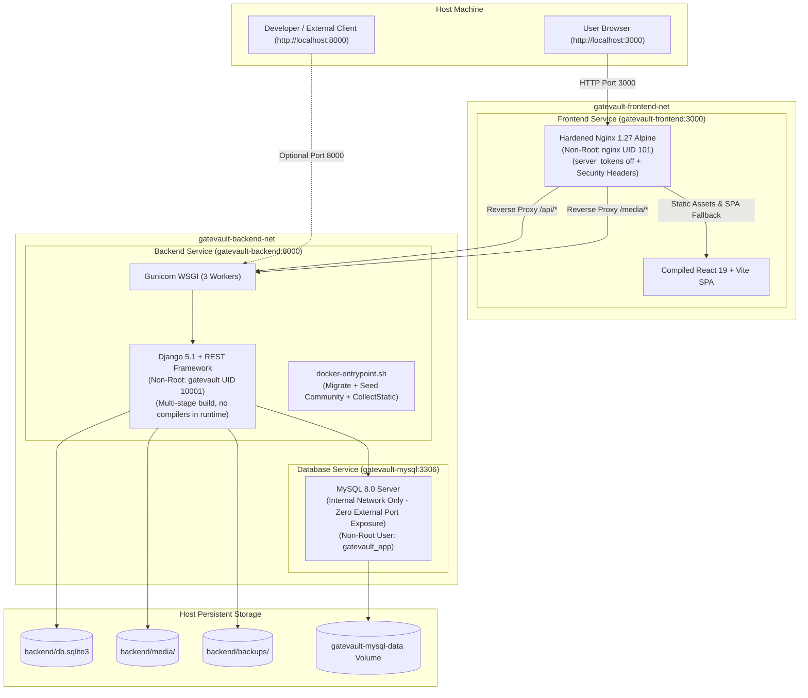

# GateVault – Docker Setup & Hardened Deployment Guide

This document provides complete instructions for running the **GateVault – Smart Parcel Management and Secure Handover System** using hardened Docker and Docker Compose.

---

## 1. System Architecture in Docker

GateVault operates across isolated bridge networks with defense-in-depth containerization:



### Key Security Highlights
- **Least Privilege Execution**: Backend runs as `gatevault` (UID 10001), frontend runs as `nginx` (UID 101).
- **Kernel Capability Dropping**: All containers drop all Linux capabilities (`cap_drop: [ALL]`).
- **No Privilege Escalation**: Prevents setuid attacks (`security_opt: [no-new-privileges:true]`).
- **Network Segmentation**: Frontend cannot communicate directly with the database container.
- **Persistent Data**: SQLite (`backend/db.sqlite3`), media files (`backend/media/`), and backups (`backend/backups/`) survive container rebuilds.
- **Resource Constraints**: CPU limits (1.5 CPUs) and memory limits (1GB RAM) protect against resource exhaustion.

---

## 2. Quick-Start Commands

### A. Run with SQLite (Default Local Mode)
```powershell
# Navigate to project root
cd "c:\Users\saivi\OneDrive\Documents\Gate Vault"

# Build images and start containers
docker-compose up -d --build

# Verify container status
docker-compose ps
```

### B. Run with Dedicated MySQL 8.0 Container
```powershell
# Start with MySQL profile
docker-compose --profile mysql up -d --build
```

### C. Access Applications
- **Frontend App**: [http://localhost:3000](http://localhost:3000)
- **Backend API**: [http://localhost:8000/api/](http://localhost:8000/api/)
- **API Health Check**: [http://localhost:8000/api/towers/](http://localhost:8000/api/towers/)

### D. Useful Operational Commands
```powershell
# Tail live backend logs
docker-compose logs -f backend

# Tail live frontend logs
docker-compose logs -f frontend

# Create an on-demand database backup
docker-compose exec backend python manage.py backup_db

# Run migrations inside container
docker-compose exec backend python manage.py migrate

# Stop containers safely (preserves database records)
docker-compose stop
```

---

> [!CAUTION]
> **NEVER RUN `docker-compose down -v` IN PRODUCTION.**  
> Running `down -v` deletes named volumes and will erase your MySQL database volume. Always use `docker-compose stop` or `docker-compose down`.
