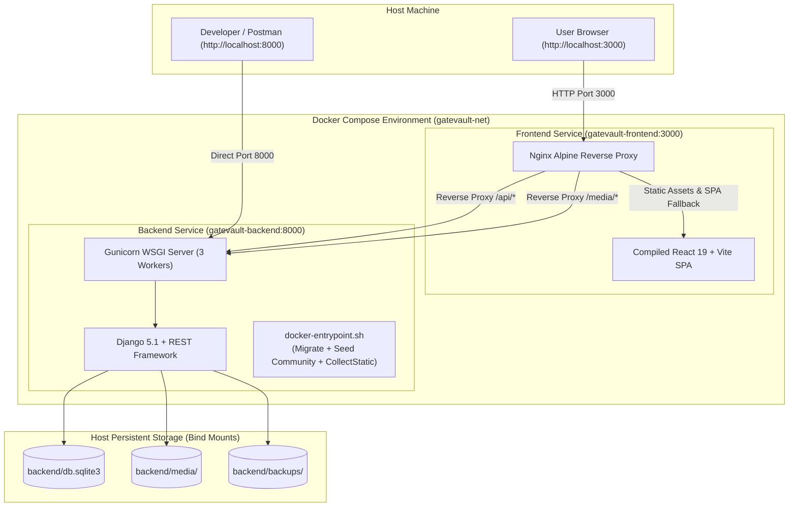

# GateVault – Docker Setup & Deployment Guide

This document provides complete instructions for running the **GateVault – Smart Parcel Management and Secure Handover System** locally using Docker and Docker Compose.

---

## 1. System Architecture in Docker

When deployed with Docker, GateVault operates across two dedicated container services connected via an internal bridge network (`gatevault-net`):



### Key Highlights
- **Single Entry Point**: Access the entire application seamlessly at `http://localhost:3000`.
- **Zero CORS Issues**: Nginx reverse-proxies `/api/` and `/media/` directly to the backend service internally.
- **Persistent Data**: The SQLite database (`backend/db.sqlite3`) and uploaded images (`backend/media/`) are bind-mounted to the host so no data is lost on container stop or rebuild.
- **Production-Ready**: Multi-stage Node.js build served via Nginx on the frontend, and Gunicorn WSGI workers on the backend.
- **Zero Application Modifications**: Existing database schemas, APIs, JWT authentication, and live Vercel/Render configurations remain 100% untouched.

---

## 2. Prerequisites

1. **Docker Desktop** (Windows or macOS) or **Docker Engine + Docker Compose** (Linux):
   - [Download Docker Desktop for Windows](https://www.docker.com/products/docker-desktop/)
   - Ensure Docker Desktop is launched and the Docker engine status shows **Running**.
2. **Git** (for repository management).

Verify your Docker installation by running in your terminal:
```bash
docker --version
docker compose version
```
*(Note: If using standalone Docker Compose, `docker-compose version` also works.)*

---

## 3. Quick Start (Run Locally in One Command)

1. Open PowerShell, Command Prompt, or your terminal at the root directory of GateVault:
   ```bash
   cd "Gate Vault"
   ```

2. *(Optional)* Copy the environment template:
   ```bash
   cp .env.example .env
   ```

3. Build and launch all services:
   ```bash
   docker compose up --build
   ```
   *(Or with hyphenated syntax: `docker-compose up --build`)*

4. Docker Compose will automatically:
   - Build the React 19 production bundle and package it with Nginx.
   - Build the Python 3.13 backend image.
   - Run database migrations (`python manage.py migrate --noinput`).
   - Seed community structure with 4 towers and 240 flats (`seed_gatevault_community`).
   - Collect static files for Django admin.
   - Start Gunicorn on port `8000` and Nginx on port `3000`.

---

## 4. Application Access & URLs

Once containers are running, access the services:

| Service | Local URL | Description |
| :--- | :--- | :--- |
| **GateVault Web App** | [http://localhost:3000](http://localhost:3000) | Complete React application (Landing, Resident, Guard, Admin) |
| **Django REST API** | [http://localhost:8000/api/](http://localhost:8000/api/) | Direct backend API endpoints (or through [http://localhost:3000/api/](http://localhost:3000/api/)) |
| **Django Admin Portal** | [http://localhost:8000/admin/](http://localhost:8000/admin/) | Django administrative panel |

---

## 5. Default Demo Credentials

GateVault includes built-in test accounts that can be used directly on `http://localhost:3000`:

| Role | Username | Password | Access Level |
| :--- | :--- | :--- | :--- |
| **Community Admin** | `admin` | `admin123` | Full community, guard, and resident administration |
| **Security Guard** | `guard1` | `guard123` | Parcel registration, QR scanning, PIN verification |
| **Resident** | `resident1` | `resident123` | Parcel tracking, pickup passes, household delegation |

*(Note: The system automatically provisions and validates these roles on initial login).*

---

## 6. Daily Management Commands

### Run in Background (Detached Mode)
```bash
docker compose up -d
```

### View Live Container Logs
```bash
# View combined logs
docker compose logs -f

# View backend logs only
docker compose logs -f backend

# View frontend logs only
docker compose logs -f frontend
```

### Stop All Services
```bash
docker compose down
```

### Create a New Django Superuser
```bash
docker compose exec backend python manage.py createsuperuser
```

### Run Custom Django Management Commands
```bash
# Re-run community seeder
docker compose exec backend python manage.py seed_gatevault_community

# Generate demo parcels and test data
docker compose exec backend python manage.py generate_demo_data
```

### Rebuild Containers After Code Changes
```bash
docker compose up --build -d
```

---

## 7. Storage & Data Persistence

The project is configured with host bind mounts in `docker-compose.yml`:
- **Database**: `./backend/db.sqlite3:/app/db.sqlite3`
  - All users, flats, parcels, pickup records, and audit logs are stored directly on the host machine.
- **Media Uploads**: `./backend/media:/app/media`
  - Uploaded parcel photographs, condition inspection snapshots, and signature proofs are saved to your local `backend/media` directory.
- **Backups**: `./backend/backups:/app/backups`
  - Admin database snapshots are saved directly to `backend/backups`.

Stopping or deleting Docker containers will **never** delete your community data.

---

## 8. Troubleshooting

### 1. "error during connect: ... The system cannot find the file specified"
- **Cause**: Docker Desktop is not running.
- **Fix**: Launch Docker Desktop from your Start menu or Applications folder and wait until it finishes starting.

### 2. "Port 3000 (or 8000) is already in use"
- **Cause**: Another process on your machine is using port 3000 or 8000.
- **Fix**: Open `.env` (or copy from `.env.example`) and configure alternative ports:
  ```env
  FRONTEND_PORT=3001
  BACKEND_PORT=8001
  ```
  Then run `docker compose up --build`.

### 3. Windows CRLF Line Endings
- **Cause**: Windows Git checkouts sometimes convert Unix `\n` line endings to Windows `\r\n` (CRLF), which can cause `/bin/sh^M: bad interpreter` inside Linux containers.
- **Protection**: `backend/Dockerfile` automatically runs `sed -i 's/\r$//' /app/docker-entrypoint.sh` during the build step, ensuring full compatibility regardless of host OS.

### 4. SPA Refresh Returns 404
- **Protection**: `frontend/nginx.conf` is configured with `try_files $uri $uri/ /index.html;`, ensuring refreshing routes like `/resident`, `/guard`, or `/admin` routes properly through React Router.

