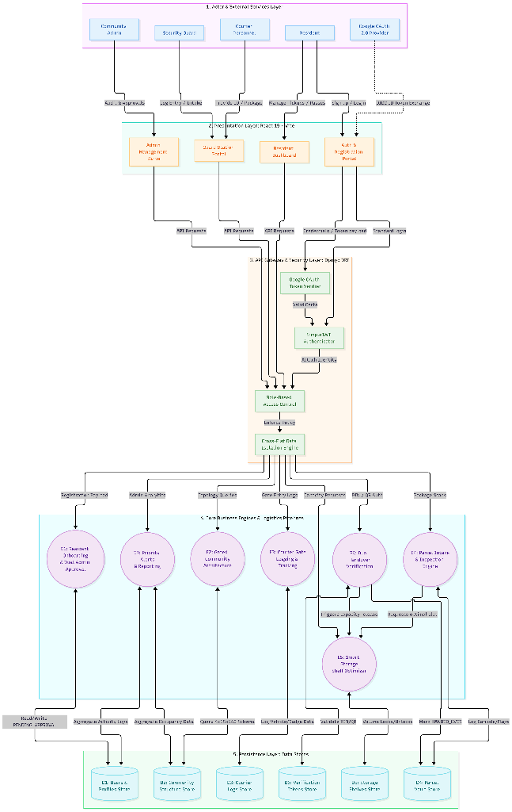

# GateVault

<p align="center">
  
</p>

<p align="center">
  <strong>Digital Chain of Custody & Smart Logistics Platform for Modern Gated Residential Communities</strong>
</p>

<p align="center">
  <a href="https://gate-vault-self.vercel.app"></a>
  <a href="https://gatevault.onrender.com"></a>
  
  
</p>

---

## 🌟 Live Deployments

- **Frontend Application (Vercel):** [https://gate-vault-self.vercel.app](https://gate-vault-self.vercel.app)
- **Backend REST API (Render):** [https://gatevault.onrender.com](https://gatevault.onrender.com)
- **GitHub Repository:** [https://github.com/SAIVINAY983/GateVault.git](https://github.com/SAIVINAY983/GateVault.git)

---

## 📖 Project Overview

In high-density gated residential communities, manual delivery tracking leads to package theft, gatehouse congestion, disputes over damaged goods, and uncollected parcels.

**GateVault** eliminates these problems by enforcing a **zero-trust, digital chain of custody** from courier arrival to resident handover. Every package is scanned, inspected with photographic proof, assigned to a space-optimized smart storage shelf, and released exclusively via **cryptographic QR pickup passes** or **dynamic 6-digit PIN verification**.

The application is pre-configured with **GateVault Residency**—a realistic gated community topology of **4 Towers, 15 Floors per tower, and 240 individual flats**, backed by dual registration approval (Password + Google OAuth 2.0), smart shelves, courier logs, emergency broadcasts, and automated disaster recovery.

---

## 🏢 Community Architecture: GateVault Residency

GateVault features an authentic residential community model:

| Component | Configuration | Details |
|---|---|---|
| **Community Name** | **GateVault Residency** | Demo residential community topology |
| **Total Towers** | **4** | `Tower A`, `Tower B`, `Tower C`, `Tower D` |
| **Floors per Tower** | **15** | Ground Floor (0) + Floors 1 through 14 |
| **Flats per Floor** | **4** | Standard Indian numbering: `G001`–`G004`, `101`–`104` ... `1401`–`1404` |
| **Flats per Tower** | **60** | 4 ground-floor units + 56 upper-floor units |
| **Total Community Flats**| **240** | Stored as strings with dynamic model-derived floor numbers |
| **Seeding Command** | `seed_gatevault_community` | Idempotent Django management command |

---

## 🚀 The 16 Complete Core Feature Modules

### 1. Parcel Intake & Visual Chain of Custody
- Guards scan package barcodes or input tracking numbers on arrival.
- Capture physical condition (Intact, Dented, Tampered, Retaped) with high-res photo proof.
- Automatically generates parcel ID, initial intake timestamp, and assigned shelf placement.

### 2. Dual Pickup Verification (Dynamic PIN & QR Pass)
- **Dynamic 6-Digit PIN:** Unique, non-guessable PIN dispatched to resident upon arrival.
- **HMAC-SHA256 QR Pickup Pass:** Time-limited, rotatable cryptographic pass scanned by guard webcam/scanner.
- Instant, atomic custody handover: parcel status transitions to `HANDED_OVER` and releases storage shelf capacity.

### 3. Google OAuth 2.0 & Resident Onboarding
- One-click "Continue with Google" sign-in exclusively for residents.
- Rigorous server-side Google ID-token signature verification via Google OIDC public certs.
- Anti-tampering signed onboarding tokens prevent identity spoofing. Guards and Admins are strictly barred from Google OAuth.

### 4. Gated Community Architecture (240 Flats)
- 4 Towers (`Tower A`, `Tower B`, `Tower C`, `Tower D`), 15 Floors, 240 Flats.
- Standardized numbering convention (`G001`–`G004`, `101`–`104` ... `1401`–`1404`).
- Real-time floor derivation directly on model properties without database schema overhead.

### 5. Cascading 3-Tier Resident Registration
- Cascading dropdowns: **Field 1: Tower** $\rightarrow$ **Field 2: Floor** $\rightarrow$ **Field 3: Flat Number** (displaying only the 4 units on that floor).
- Changing parent dropdown resets child selections.
- Independent backend verification ensures submitted IDs belong to the authentic tower/floor hierarchy, rejecting forged room numbers.

### 6. Dual Registration Approval & Quarantine
- Every new resident (whether Password or Google OAuth) starts with `approval_status = 'PENDING_APPROVAL'`.
- Quarantined residents are blocked by `IsResidentUser` from viewing parcel data or accessing the Resident Dashboard.
- Community Admin reviews, approves, or rejects (with a mandatory explanation reason).

### 7. Community Admin Approval & Audit Console
- Audit table in Admin Users dashboard with 10 columns: Resident Name, Email, Method (Google/Password), Tower, Floor, Flat, Date, Status, Actions.
- Real-time filtering by **Tower**, **Floor**, and **Approval Status**.
- Complete inspection modal showing resident registration details, rejection reasons, and approval audit timestamps.

### 8. Interactive Community Overview & Real-Time Occupancy
- High-level community dashboard displaying live occupancy metrics across 240 units:
  - `OCCUPIED`: Flat has at least 1 approved resident profile.
  - `PENDING_VERIFICATION`: Flat has pending registrations but no approved resident yet.
  - `VACANT`: Flat has 0 registered residents.
- Interactive drill-down: Click Tower $\rightarrow$ Click Floor $\rightarrow$ View 4 Flat cards with resident counts.

### 9. Community Facilities & Amenities Catalog
- Integrated descriptive catalog of **16 community facilities**:
  Main security entrance, security guard cabin, courier entry area, parcel receiving room, secure storage area, central garden, children's play area, clubhouse, community hall, gymnasium, indoor games room, visitor parking, resident parking, walking pathway, waste collection area, maintenance office.

### 10. Smart Storage Shelf Space Optimization
- Real-time shelf capacity tracking and near-capacity visual warnings ($>85\%$ threshold).
- Space recommendation algorithm matching parcel dimensions to optimal shelf slots.
- Temporary reservation locks preventing simultaneous shelf over-allocation.

### 11. Courier Visit & Vehicle Gate Logging
- Entry and exit logging for couriers (Amazon, Flipkart, Swiggy, Zomato, BlueDart, DTDC).
- Captures badge IDs, carrier company, vehicle registration plate, and parcels delivered.
- Dwell-time calculation detecting delivery personnel spending excessive time on premises.

### 12. Scheduled Deliveries & Expected Delivery Pre-Alerts
- Residents can pre-notify the gatehouse about incoming packages before they arrive.
- Delivery calendar for security guards to prepare for expected courier volume.
- Auto-matching incoming package barcodes against scheduled resident notices.

### 13. Household Members & Delegated Guest Authorizations
- Primary residents can add flatmates with granular permissions.
- **Guest Pickup Authorization:** Issue time-limited pickup passes to friends, domestic staff, or neighbors.

### 14. Incident Management & Discrepancy Workflows
- Report damaged goods, missing items, or wrong flat delivery disputes.
- Full resolution lifecycle: `OPEN` $\rightarrow$ `UNDER_REVIEW` $\rightarrow$ `RESOLVED` $\rightarrow$ `CLOSED`.
- Attached photo evidence, guard inspection notes, and admin resolution logs.

### 15. Guard Shift Management & Handover Reporting
- Shift clock-in/clock-out tracking for morning, evening, and night shifts.
- Digital shift handover reports summarizing pending packages, overdue parcels, and open incidents.
- Mandatory peer acceptance workflow for secure shift transfers.

### 16. Automated Backups & Multi-Format Reporting
- Export delivery logs, courier visits, guard shifts, and incident reports to **PDF**, **Excel (.xlsx)**, and **CSV**.
- On-demand and automated database backup snapshots for disaster recovery.

---

## 🔒 Security & Role-Based Access Control (RBAC)

GateVault enforces strict zero-trust boundaries:

```
[ Unauthenticated Requests ] ──► [ SimpleJWT / Google Token Verifier ]
                                          │
                                          ▼
                               [ Role-Based Permissions ]
                ┌─────────────────────────┼─────────────────────────┐
                ▼                         ▼                         ▼
         [ RESIDENT ]                  [ GUARD ]                 [ ADMIN ]
      - Flat Isolation           - Intake Scanner           - System Settings
      - Pickup Passes / PIN      - PIN/QR Verification      - Resident Approvals
      - Personal History         - Courier Log              - 240-Flat Occupancy
      - Feedback Rating          - Shift Handover           - PDF/Excel Reports
```

- **Cross-Flat Data Isolation:** Every database query filters by `resident_profile.flat_id`. A resident can NEVER query or access parcels belonging to another unit.
- **Tamper-Proof Verification:** QR codes contain cryptographically signed tokens (HMAC-SHA256); modifying the payload immediately invalidates verification.
- **Quarantine Enforcement:** DRF permission `IsResidentUser` strictly rejects `PENDING_APPROVAL` and `REJECTED` residents with `403 Forbidden`.

---

## 🛠️ Technology Stack

| Layer | Technologies |
|---|---|
| **Frontend** | React 19, Vite, React Router 7, Axios, Bootstrap 5, Bootstrap Icons, Recharts, HTML5-QRCode, Canvas-Confetti |
| **Backend** | Python 3.13, Django 5.x, Django REST Framework (DRF), SimpleJWT, Django Channels (ASGI ready) |
| **External Auth** | Google Identity Services (Google OAuth 2.0 / OpenID Connect) |
| **Database** | SQLite (Dev/Staging), PostgreSQL (Render Production) |
| **Reporting** | ReportLab (PDF generation), openpyxl (Excel exports), Python CSV |
| **Deployment** | Vercel (Frontend Global CDN), Render (Backend Web Service) |

---

## 📂 Project Directory Structure

```text
GateVault/
├── backend/
│   ├── api/
│   │   ├── management/commands/
│   │   │   └── seed_gatevault_community.py # Idempotent community seeder (4 towers, 240 flats)
│   │   ├── models.py                       # Flat, Tower, User, Parcel, Shelf, etc.
│   │   ├── serializers.py                  # Validations & Floor Derivation Serializers
│   │   ├── views.py                        # ViewSets, Community Overview, Approvals, Intake
│   │   ├── oauth.py                        # Google OAuth token verification
│   │   └── urls.py                         # REST API endpoint routes
│   ├── gatevault/                          # Django settings and ASGI/WSGI
│   ├── db.sqlite3                          # Local development database
│   ├── manage.py                           # Django CLI
│   └── requirements.txt                    # Python dependencies
├── frontend/
│   ├── public/                             # Static assets
│   ├── src/
│   │   ├── components/
│   │   │   ├── auth/                       # GoogleLoginButton, ResidentGoogleOnboardingModal
│   │   │   ├── guard/                      # QRScannerComponent
│   │   │   └── ui/                         # Sidebar, Topbar, StatusBadge, Cards
│   │   ├── context/                        # AuthContext (JWT & Google OAuth state)
│   │   ├── pages/
│   │   │   ├── admin/                      # AdminDashboard, AdminCommunity, AdminUsers, etc.
│   │   │   ├── guard/                      # ParcelIntake, PickupVerification, CourierVisits, etc.
│   │   │   ├── resident/                   # ResidentDashboard, MyFeedback, Household, etc.
│   │   │   ├── Login.jsx                   # Role-aware login with Google OAuth button
│   │   │   └── Register.jsx                # Cascading Tower->Floor->Flat registration
│   │   ├── App.jsx                         # React Router 7 definitions
│   │   └── main.jsx                        # Entry point
│   ├── package.json                        # Node dependencies
│   └── vite.config.js                      # Vite build configuration
├── docs/
│   └── gatevault_architecture.png          # Master System Architecture Blueprint
├── GATEVAULT_PROJECT_REPORT.md             # Comprehensive End-to-End Project Report
└── README.md                               # Project documentation
```

---

## 🧪 Automated Testing Suite (394/394 Tests Passing)

GateVault maintains an exhaustive automated test suite. **All 394 automated tests pass with 100% success rate**:

```text
=================================================================================
GATEVAULT AUTOMATED TEST SUITE EXECUTION SUMMARY
=================================================================================
1. test_community_structure.mjs (Towers, Flats, Seeder, Occupancy) -> 57/57 PASSED
2. test_dual_approval.mjs (Dual Password + Google Approval Logic)  -> 29/29 PASSED
3. test_google_oauth.mjs (Google Identity & Backend Verification)   -> 52/52 PASSED
4. test_smart_shelf.mjs (Smart Shelf Recommendations & Capacity)    -> 25/25 PASSED
5. test_courier_visits.mjs (Courier Logistics & Vehicle Logging)   -> 26/26 PASSED
6. test_delivery_scheduling.mjs (Expected Delivery Pre-alerts)      -> 47/47 PASSED
7. test_guest_authorization.mjs (Guest Pass & Household Members)    -> 22/22 PASSED
8. test_priority_alerts.mjs (Emergency Alerts & Incidents)          -> 69/69 PASSED
9. test_community_feedback.mjs (5-Star Ratings & Reviews)          -> 52/52 PASSED
10. test_reports_backup.mjs (PDF/Excel Exports & DB Backups)        -> 35/35 PASSED
---------------------------------------------------------------------------------
TOTAL TESTS EXECUTED: 394 PASSED | 0 FAILED | 100% SUCCESS RATE
=================================================================================
```

Frontend production build verification (`npm --prefix frontend run build`):
- **Modules Transformed:** 701 modules
- **Build Time:** 1.03s
- **Errors / Warnings:** 0

---

## ⚡ Local Setup & Installation

### 1. Clone the Repository
```bash
git clone https://github.com/SAIVINAY983/GateVault.git
cd GateVault
```

### 2. Backend Setup (Django)
```bash
cd backend
python -m venv venv
# On Windows:
venv\Scripts\activate
# On Linux/macOS:
source venv/bin/activate

pip install -r requirements.txt
python manage.py migrate

# Seed GateVault Residency (4 Towers, 15 Floors, 240 Flats)
python manage.py seed_gatevault_community

# Start Django Development Server
python manage.py runserver
```

### 3. Frontend Setup (React + Vite)
```bash
cd ../frontend
npm install
npm run dev
```
Open [http://localhost:5173](http://localhost:5173) in your browser.

---

## 🔑 Demo Login Accounts

| Role | Username | Password | Access Details |
|---|---|---|---|
| **Community Admin** | `admin` | `adminpass` | Full admin privileges, resident approvals, 240-flat community overview |
| **Security Guard** | `guard1` | `guardpass` | Intake scanner, webcam QR verification, courier visit logs |
| **Resident (Approved)** | `resident1` | `respass` | Tower A, Flat 101, view pending parcels, PIN/QR passes |
| **Resident (Google)** | Continue with Google | *Google Auth* | Seamless Google login for approved resident accounts |

---

## 📄 License

This project is licensed under the MIT License. Built for secure, digital chain of custody in modern gated residential communities.
