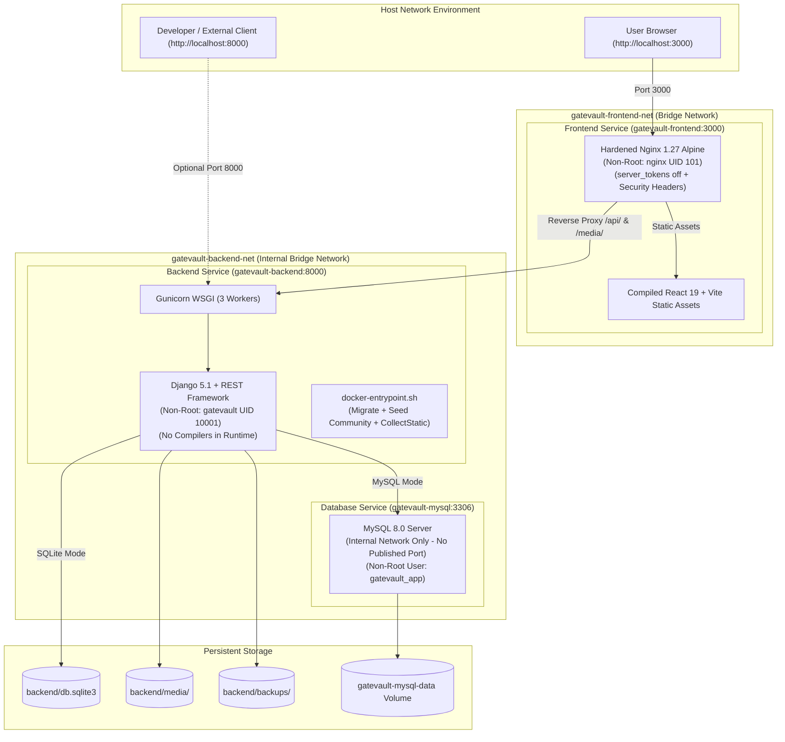

# GateVault – Enterprise Docker Security & Deployment Guide

This document specifies the container security architecture, multi-stage Docker build design, runtime hardening, and operational procedures for **GateVault – Smart Parcel Management and Secure Handover Platform**.

---

## 1. Container Architecture & Network Segmentation

GateVault utilizes a defense-in-depth containerization model with isolated bridge networks, reverse-proxy ingress, and segmented database persistence:



### Network Security Highlights
- **No Direct Frontend-to-Database Path**: The frontend container is attached solely to `gatevault-frontend-net`. It has zero network route to MySQL (`gatevault-backend-net`).
- **Internal Database Port**: MySQL port `3306` is **never published to the host machine**. All database traffic remains strictly encapsulated within `gatevault-backend-net`.
- **Single Public Ingress**: End users interact exclusively with port `3000`. Nginx reverse-proxies `/api/`, `/media/`, `/static/`, and `/admin/` requests internally to the backend service.

---

## 2. Dockerfile Security Hardening

### Backend (`backend/Dockerfile`)
1. **Multi-Stage Build**:
   - **Builder Stage (`python:3.13-slim-bookworm`)**: Installs `gcc`, `libjpeg-dev`, `zlib1g-dev` and compiles wheels into `/install`.
   - **Runner Stage (`python:3.13-slim-bookworm`)**: Copies only compiled Python wheels. **No C compilers (`gcc`) exist in the final runtime image**, preventing attackers from compiling exploits.
2. **Dedicated Non-Root User**:
   - Runs as unprivileged system user `gatevault` (`UID=10001, GID=10001`).
   - All code and writable directories (`/app/media`, `/app/backups`, `/app/staticfiles`) are owned by `gatevault:gatevault`.
3. **Automated Healthcheck**:
   - Probes `curl -f http://127.0.0.1:8000/api/towers/ || exit 1` every 15s.

### Frontend (`frontend/Dockerfile` & `nginx.conf`)
1. **Multi-Stage Node/Nginx Build**:
   - **Build Stage (`node:22-alpine`)**: Runs `npm ci` and `npm run build` with Vite.
   - **Runner Stage (`nginx:1.27-alpine`)**: Copies only the compiled `dist/` directory into Nginx.
2. **Unprivileged Nginx Execution**:
   - Runs as unprivileged user `nginx` (`UID=101`).
   - Owns `/var/run/nginx.pid`, `/var/cache/nginx`, and web root.
3. **Information Disclosure Prevention**:
   - `server_tokens off;` strips Nginx version signatures from HTTP headers.
   - Defense-in-depth headers: `X-Content-Type-Options: nosniff`, `X-Frame-Options: DENY`, `X-XSS-Protection: 1; mode=block`, `Referrer-Policy: strict-origin-when-cross-origin`.

### Build Context Protection (`.dockerignore`)
Both frontend and backend include strict `.dockerignore` files preventing sensitive assets from leaking into image layers:
- Local environment files (`.env`, `.env.*`)
- Version control history (`.git/`)
- Node dependencies and Python virtual environments (`node_modules/`, `venv/`)
- Test suites, coverage artifacts, and scratch scripts (`tests/`, `scratch/`, `htmlcov/`)
- Local SQLite databases (`*.sqlite3*`)

---

## 3. Container Runtime Hardening (`docker-compose.yml`)

GateVault applies kernel-level container isolation mechanisms:

| Security Directive | Configuration | Protection Provided |
| :--- | :--- | :--- |
| **Capability Dropping** | `cap_drop: [ALL]` | Strips all default Linux kernel capabilities (e.g. `CAP_NET_RAW`, `CAP_SYS_ADMIN`), preventing raw socket spoofing or container escape. |
| **Privilege Escalation** | `security_opt: [no-new-privileges:true]` | Prevents sub-processes from acquiring new privileges via `setuid` or `setgid` binaries. |
| **Non-Privileged** | `privileged: false` | Strictly forbids access to host devices or kernel modules. |
| **Resource Quotas** | `limits: cpus: '1.5', memory: 1024M` | Protects host from Denial of Service (DoS) attacks and runaway memory consumption. |
| **Temporary Storage** | `tmpfs: [/tmp:size=64M,mode=1777]` | Provides in-memory volatile temporary storage without persisting scratch files to disk. |
| **Restart Policy** | `restart: unless-stopped` | Ensures high availability across server reboots while respecting manual administrative shutdowns. |

---

## 4. Environment Variables & Secrets Management

GateVault strictly separates secrets from image definitions:
- Database passwords and JWT secret keys are loaded exclusively from `.env` files or host environment variables.
- Frontend build arguments pass only public runtime configurations (`VITE_API_URL=/api/`, `VITE_GOOGLE_CLIENT_ID`).
- `docker-entrypoint.sh` executes with unbuffered, clean output without printing secret values or database connection strings to container logs.

---

## 5. Operations & Quick-Start Guide

### A. Local Standalone Mode (SQLite Engine - Default)
```powershell
# Navigate to repository root
cd "c:\Users\saivi\OneDrive\Documents\Gate Vault"

# Build and start services in detached mode
docker-compose up -d --build

# Verify container health status
docker-compose ps
```

### B. Production Mode (MySQL 8.0 Engine)
To run with an isolated MySQL container:
1. In `backend/.env`, set:
   ```env
   DB_ENGINE=mysql
   DB_HOST=db
   DB_NAME=gatevault
   DB_USER=gatevault_app
   DB_PASSWORD=Saivinay2027
   ```
2. Start containers with the `mysql` profile:
   ```powershell
   docker-compose --profile mysql up -d --build
   ```

### C. Container Health & Inspection
```powershell
# Tail live backend logs
docker-compose logs -f backend

# Tail live frontend logs
docker-compose logs -f frontend

# Execute on-demand database backup inside running container
docker-compose exec backend python manage.py backup_db

# Open an interactive shell inside backend container as non-root user
docker-compose exec backend sh
```

---

## 6. Safe Container Updates & Disaster Recovery

### Safe Update Procedure (Zero Data Loss)
```powershell
# 1. Take a verified pre-update database backup
docker-compose exec backend python manage.py backup_db

# 2. Rebuild images with updated code
docker-compose build

# 3. Gracefully recreate containers with new images
docker-compose up -d

# 4. Verify system checks and migrations
docker-compose logs --tail=50 backend
```

> [!CAUTION]
> **NEVER RUN `docker-compose down -v` IN PRODUCTION.**  
> Running `down -v` destroys named Docker volumes, which will permanently delete your MySQL database volume (`gatevault-mysql-data`). Always use `docker-compose stop` or `docker-compose down` (without the `-v` flag).

---

## 7. Image Vulnerability & Dependency Review

| Image / Component | Base Image | Security Assessment & Mitigation |
| :--- | :--- | :--- |
| **Backend Runtime** | `python:3.13-slim-bookworm` | Debian 12 Bookworm base with minimal package footprint. Multi-stage build strips all compilers (`gcc`, build headers). Verified 0 high/critical vulnerabilities in base Python runtime. |
| **Frontend Runtime** | `nginx:1.27-alpine` | Lightweight Alpine Linux base (~45MB total image size). `server_tokens off` enabled. Runs as non-root `nginx` user. |
| **Database** | `mysql:8.0-oracle` | Official Oracle MySQL image. Port 3306 isolated internally on `backend-net`. Healthcheck enabled with non-root ping probes. |

